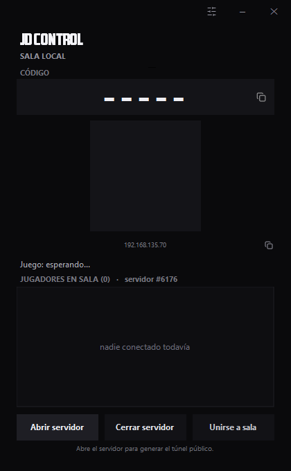
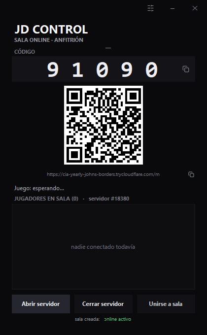
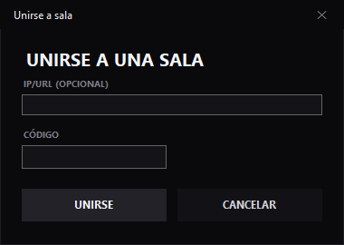
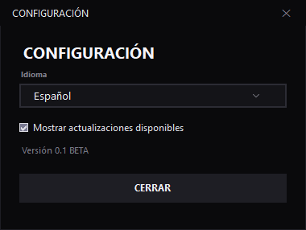
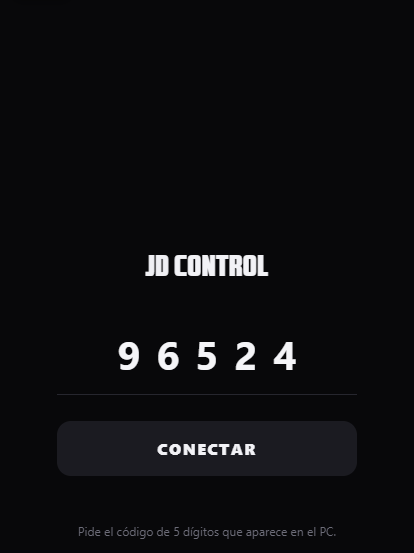
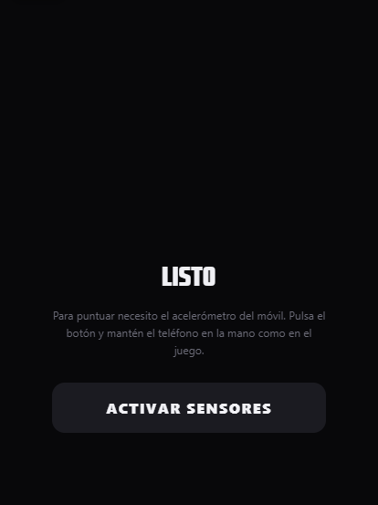
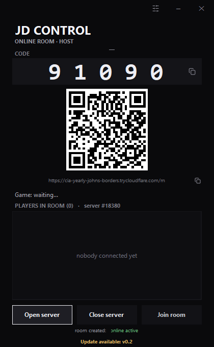

<h1 align="center">JD CONTROL</h1>

<p align="center">
  <a href="https://github.com/nxx-sudo/JD-Control/releases"></a>
  <a href="LICENSE"></a>
  <a href="https://github.com/nxx-sudo/JD-Control/releases"></a>
  <a href="https://discord.gg/TU-INVITACION"></a>
</p>

<p align="center">
  Controlador con el móvil para <b>Just Dance Legacy</b> en PC: sala local, multijugador entre PCs y túnel público para jugar desde cualquier red.
</p>

---

## Qué es

JD CONTROL es un mod de escritorio que abre una **sala local** en tu PC y conecta los móviles como mandos (flechas, OK, pausa y acelerómetro para puntuar). No modifica el juego: habla con él por la interfaz que ya expone `Legacy.exe`.

- **Varios móviles** a la vez, cada uno con su jugador.
- **Sala entre PCs**: un PC abre la sala y los demás se unen con el código.
- **Cualquier red**: un túnel `cloudflared` publica tu PC en HTTPS, así el móvil conecta desde datos móviles sin abrir puertos.
- **3 idiomas**: English, Español y Portuguese (Brasil).

## Capturas

| Sala cerrada | Sala creada (online activo) |
| :--: | :--: |
|  |  |

| Unirse a una sala desde el PC | Ajustes |
| :--: | :--: |
|  |  |

| Móvil: código | Móvil: listo para jugar |
| :--: | :--: |
|  |  |

## Cómo funciona

```
  Móvil (navegador)                PC con JD CONTROL                  Juego
  ─────────────────                ───────────────────                ─────
  /m  ─── HTTPS/WSS ───►  server.js  ── HTTP 127.0.0.1:8080 ──►  Legacy.exe
                                │
                                ├── panel .NET (JD CONTROL.exe): QR, código, jugadores
                                ├── sala online (/ws/online): otros PCs con JD CONTROL
                                └── túnel cloudflared: URL pública https://…trycloudflare.com
```

1. `JD CONTROL.exe` arranca `server.js` (Node) si no está corriendo.
2. El servidor crea el certificado local, sirve la web del móvil (`/m`) y abre el túnel público.
3. El panel muestra el **código de 5 dígitos** y el **QR** con el enlace ya listo.
4. El móvil entra, escribe el código, activa los sensores y manda las pulsaciones al servidor; el servidor las reenvía al juego.

Todo el estado (jugador, canción, fase, puntuación) vive en el PC: el móvil solo es un mando.

## Requisitos

- Windows 10/11.
- **Just Dance Legacy** (PC) con el servidor HTTP del juego en `127.0.0.1:8080`.
- Para usar el paquete ya compilado no hace falta nada más (lleva Node portable).
- Para compilar desde el código: .NET Framework 4.x (`csc.exe`) y Node.js 18+.

## Instalación

1. Descarga el zip de [Releases](https://github.com/nxx-sudo/JD-Control/releases) y descomprímelo **completo** (el `.exe` solo es la ventana; el servidor va en la carpeta).
2. Abre `JD CONTROL.exe` desde esa carpeta.
3. La primera vez descarga `cloudflared.exe` si falta (el túnel lo necesita).

## Uso

### 1. Abrir la sala


Pulsa **Abrir servidor**. El panel pasa a `sala creada: online activo` (en verde) y muestra el código y el QR.

### 2. Conectar tu móvil


Escanea el QR con la cámara del móvil o abre el enlace. Escribe el código de 5 dígitos, pulsa **CONECTAR** y luego **ACTIVAR SENSORES** (el acelerómetro solo funciona en HTTPS, y el enlace del túnel ya lo es).

### 3. Varios móviles

El mismo QR sirve para todos: cada móvil que entra ocupa un jugador. Aparecerán en **JUGADORES EN SALA** con su estado (`En el menú`, `Bailando`, …).

### 4. Cerrar la sala

Pulsa **Cerrar servidor**: se cierra la sala, se apaga el túnel y los móviles se desconectan. El panel vuelve a `SALA LOCAL`.

### 5. Unirse a una sala desde otro PC


En el otro PC: **Unirse a sala** → escribe la IP del anfitrión (`192.168.1.20`) **o** su URL de túnel (`https://algo.trycloudflare.com`) y el código.

- Misma red: vale la IP, o nada (se busca la sala por código).
- Otra red: pega la URL del túnel; puedes pegar el enlace completo del QR, se queda con el dominio.

Cada PC sigue usando su propio `Legacy.exe` y sus propios móviles; la sala sincroniza canción y fase.

### 6. Jugar desde otra red

El túnel se abre junto con la sala. La URL `https://…trycloudflare.com` cambia en cada arranque: usa siempre el QR del panel.

## Configuración


El botón de ajustes (icono de sliders, arriba a la derecha) abre:

- **Idioma**: English, Español, Portuguese (Brasil). Se detecta el idioma de Windows; si no es español ni portugués, arranca en inglés.
- **Mostrar actualizaciones disponibles**: consulta las *releases* de este repositorio al abrir el panel y avisa abajo si hay una versión nueva.



Si hay versión nueva, el aviso aparece bajo los botones y abre la página de descarga al pulsarlo. Con la misma versión publicada no se muestra nada.

Se guarda en `settings.json`, junto al ejecutable.

## Compilar

```bat
build.bat
```

Genera `JD CONTROL.exe` con `csc.exe`. Para la carpeta distribuible (con Node portable, dependencias y zip):

```bat
package.bat
```

## Estructura

```
app/                 panel nativo en C# (MainForm.cs, Lang.cs, AssemblyInfo.cs)
server.js            servidor: web del móvil, sala online y túnel
src/                 puente con el juego (gamephone.js) y túnel remoto
public/              web que carga el móvil (mobile.html, mobile.js, fuentes)
build.bat compila el exe
package.bat       genera dist/ listo para compartir
```

## Licencia

[GNU GPL v3](LICENSE). Puedes usarlo, modificarlo y redistribuirlo manteniendo el código abierto.

> El enlace de Discord es un marcador: cámbialo por el de tu servidor.
