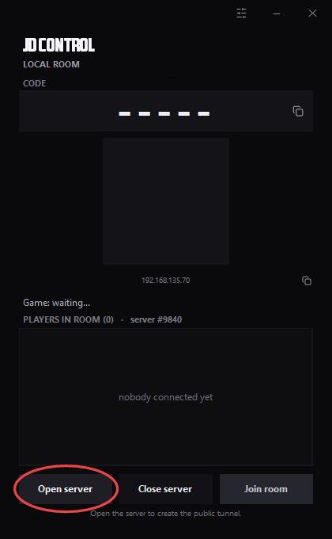
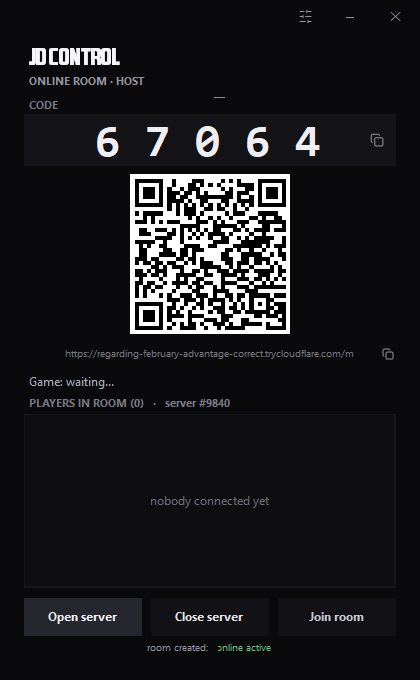
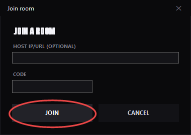
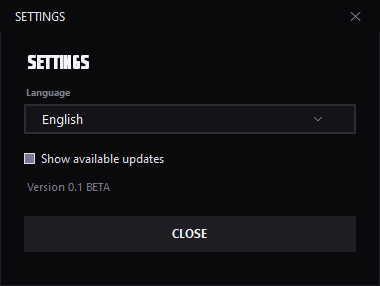
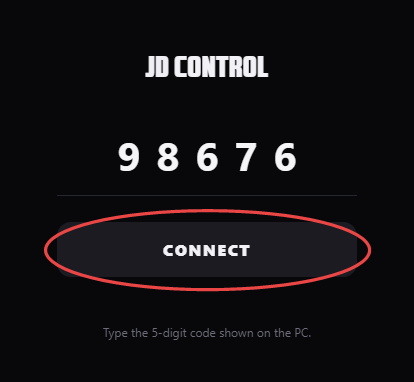
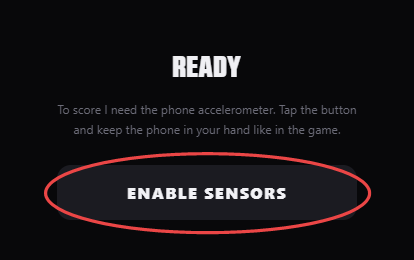

<h1 align="center">JD CONTROL</h1>

<p align="center">
  <a href="https://github.com/nxx-sudo/JD-Control/releases"></a>
  <a href="LICENSE"></a>
  <a href="https://github.com/nxx-sudo/JD-Control/releases"></a>
  <a href="https://discord.gg/TU-INVITACION"></a>
</p>

<p align="center">
  Phone controller for <b>Just Dance Legacy</b> on PC: local room, multiplayer across PCs and a public tunnel to play from any network.
</p>

---

## What it is

JD CONTROL is a desktop mod that opens a **local room** on your PC and turns phones into controllers (arrows, OK, pause and the accelerometer for scoring). It does not patch the game: it talks to it through the interface `Legacy.exe` already exposes.

- **Several phones** at once, each one with its own player.
- **Room across PCs**: one PC hosts the room and the others join with the code.
- **Any network**: a `cloudflared` tunnel publishes your PC over HTTPS, so a phone on mobile data connects without opening ports.
- **3 languages**: English, Español and Portuguese (Brazil), on the panel and on the phone.

## Screenshots

| Room closed | Room created (online active) |
| :--: | :--: |
|  |  |

| Joining a room from the PC | Settings |
| :--: | :--: |
|  |  |

| Phone: code | Phone: ready to play |
| :--: | :--: |
|  |  |

## How it works

```
  Phone (browser)               PC running JD CONTROL              Game
  ───────────────               ─────────────────────              ────
  /m  ─── HTTPS/WSS ───►  server.js  ─── local HTTP ───►  Legacy.exe
                                │
                                ├── .NET panel (JD CONTROL.exe): QR, code, players
                                ├── online room (/ws/online): other PCs with JD CONTROL
                                └── cloudflared tunnel: public URL https://…trycloudflare.com
```

1. `JD CONTROL.exe` starts `server.js` (Node) if it is not running yet.
2. The server creates the local certificate, serves the phone page (`/m`) and opens the public tunnel.
3. The panel shows the **5-digit code** and the **QR** with the link, already pointing at the room.
4. The phone opens the link, types the code, enables the sensors and sends the presses to the server; the server forwards them to the game.

All the state (player, song, phase, score) lives on the PC: the phone is only a controller.

## Requirements

- Windows 10/11.
- **Just Dance Legacy** installed on the PC.

That is all: JD CONTROL finds the running game on its own and connects to it, so you never type an address or a port. The zip also ships Node portable, so you do not need to install anything else.

To build from source you do need .NET Framework 4.x (`csc.exe`) and Node.js 18+.

## Install

1. Download the zip from [Releases](https://github.com/nxx-sudo/JD-Control/releases) and extract it **whole** (the `.exe` is only the window; the server lives in the folder).
2. Run `JD CONTROL.exe` from that folder.
3. The first time it downloads `cloudflared.exe` if it is missing (the tunnel needs it).

## Usage

### 1. Open the room


Press **Open server**. The panel switches to `room created: online active` (in green) and shows the code and the QR.

### 2. Connect your phone


Scan the QR with the phone camera or open the link. Type the 5-digit code, press **CONNECT** and then **ENABLE SENSORS**. The phone page follows the phone language (English, Spanish or Portuguese). The accelerometer only works over HTTPS, and the tunnel link already is.

### 3. Several phones

The same QR works for everyone: each phone that joins takes one player. They show up under **PLAYERS IN ROOM** with their state (`In the game`, `Dancing`, …).

### 4. Close the room

Press **Close server**: the room closes, the tunnel stops and the phones disconnect. The panel goes back to `LOCAL ROOM`.

### 5. Join a room from another PC


On the other PC: **Join room** → type the host IP (`192.168.1.20`) **or** its tunnel URL (`https://something.trycloudflare.com`) and the code.

- Same network: the IP is enough, or leave it empty (the room is found by code).
- Another network: paste the tunnel URL; you can paste the full QR link, only the domain is kept.

Each PC keeps using its own `Legacy.exe` and its own phones; the room syncs the song and the phase.

### 6. Play from another network

The tunnel opens together with the room. The `https://…trycloudflare.com` URL changes on every start: always use the QR on the panel.

## Settings


The settings button (sliders icon, top right) opens:

- **Language**: English, Español, Portuguese (Brazil). It detects the Windows language; anything other than Spanish or Portuguese starts in English.
- **Show available updates**: checks the releases of this repository when the panel opens and warns at the bottom if there is a newer version.


If there is a newer version, the notice appears under the buttons and opens the download page when clicked. With the same version published nothing is shown.

It is stored in `settings.json`, next to the executable.

## Build

```bat
build.bat
```

Produces `JD CONTROL.exe` with `csc.exe`. For the distributable folder (with portable Node, dependencies and zip):

```bat
package.bat
```

## Structure

```
app/                 native C# panel (MainForm.cs, Lang.cs, AssemblyInfo.cs)
server.js            server: phone page, online room and tunnel
src/                 bridge to the game (gamephone.js) and remote tunnel
public/              page the phone loads (mobile.html, mobile.js, fonts)
build.bat            compiles the exe
package.bat          builds dist/ ready to share
```

## License

[GNU GPL v3](LICENSE). You can use, modify and redistribute it as long as it stays open source.

> The Discord badge is a placeholder: replace it with your own server invite.
